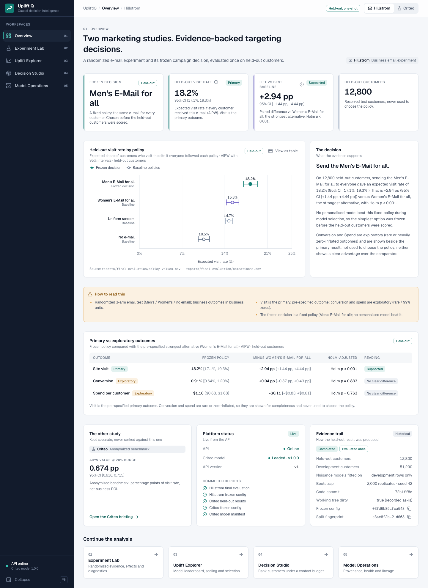
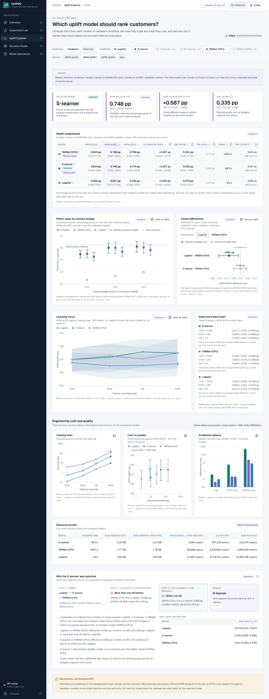
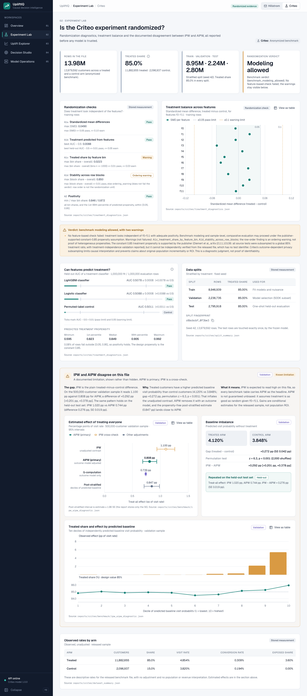
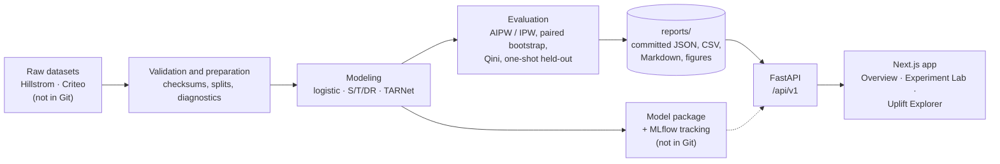

# UpliftIQ — End-to-End Causal ML & Campaign Targeting Platform


**UpliftIQ answers a marketing question that ordinary prediction cannot: _who should we contact, and does contacting them actually change what they do?_**
It combines randomized-experiment analysis, causal inference and uplift modeling on two public datasets, evaluates every decision on data that was held back until the very end, and presents the evidence in an interactive analytics application.

> **Status:** analysis, modeling, API and the Overview, Experiment Lab and Uplift Explorer workspaces are complete. Decision Studio, Model Operations and deployment are still to come ([details](#project-status)). The app is **not publicly deployed**; run it locally.



## Contents

[The problem](#the-problem) · [What it does](#what-it-does) · [Results](#results) · [The application](#the-application) · [Architecture](#architecture) · [Tech stack](#tech-stack) · [Run it locally](#run-it-locally) · [Model artifact and reproducibility](#model-artifact-and-reproducibility) · [Project status](#project-status) · [Limitations](#limitations)

## The problem

A campaign budget is limited. Sending an e-mail or showing an ad to everyone is wasteful if some customers would have bought anyway, or would never respond. A predictive model that finds "likely buyers" does not solve this, because it cannot separate people the campaign *changes* from people it merely *reaches*.

**Uplift modeling** estimates the *difference a campaign makes for each customer*, and **causal inference** is what makes that difference trustworthy. UpliftIQ walks through the full path: test whether the campaign works at all, learn who responds, choose a model with a pre-specified rule, and evaluate the final decision once on untouched data.

## What it does

| Capability | What is implemented |
|:--|:--|
| **A/B testing** | Randomization checks, treatment effects with confidence intervals, Holm correction across six comparisons, primary vs. exploratory outcomes |
| **Causal inference** | Inverse-propensity (IPW) and doubly robust (AIPW) policy-value estimation with paired bootstrap intervals; a documented diagnosis of why IPW and AIPW disagree on the Criteo file |
| **Uplift modeling** | Logistic baseline, S-, T- and DR-learners (LightGBM) and a TARNet neural network (PyTorch), compared on a learning curve from 100K to 8.9M training rows |
| **Contact-budget targeting** | Policy value when only the top 10%, 20% or 30% of customers (ranked by predicted uplift) are contacted, versus random targeting |
| **Disciplined evaluation** | Frozen configuration and selection rule, a one-shot held-out evaluation, checksums and split fingerprints, stored evaluation records |
| **Model packaging and tracking** | Versioned model package with a manifest and checksums, local MLflow tracking |
| **Analytics application** | FastAPI backend serving the stored reports (and live scoring when a model is provisioned) and a Next.js app with an Overview, an Experiment Lab and an Uplift Explorer |

## Results

Everything below comes from the reports committed in [`reports/`](reports/), which the application reads directly. "pp" means percentage points; intervals are 95%.

### Datasets

| | Hillstrom e-mail experiment | Criteo uplift benchmark (v2.1) |
|:--|:--|:--|
| Rows | 64,000 customers | 13,979,592 rows |
| Design | 3 randomized arms: Men's e-mail (21,307), Women's e-mail (21,387), no e-mail (21,306) | 85% treated, 15% control; anonymized features f0–f11 |
| Outcome | Site visit (primary); conversion and spend (exploratory) | Visit |
| Splits | 51,200 development (5-fold CV) · 12,800 held-out | 8,946,939 train · 2,236,735 validation · 2,795,918 held-out test |
| Nature | Business-facing, e-mail marketing | Anonymized benchmark; results are in percentage points of visit rate, never currency |

### Hillstrom: both e-mails work, and personalization did not beat the simple policy

- **The experiment is sound.** No pre-treatment covariate is imbalanced (all max standardized differences < 0.1).
- **Both e-mails raise visits** over sending nothing (10.6% visit rate): Men's **+7.66 pp** [+7.00, +8.32] and Women's **+4.52 pp** [+3.89, +5.16], both significant after Holm correction. Conversion and spend are exploratory; spend is noisy because about 99% of customers spend nothing.
- **Model selection on development data only.** Four personalized models (logistic, LightGBM S-, T- and DR-learner) were compared with four fixed policies. The best personalized model, the T-learner, differed from "Men's e-mail for all" by +0.12 pp [−0.24, +0.49], an interval that includes zero. Under the pre-specified rule (simplest option within one paired standard error of the best), the selected policy is **Men's e-mail for all**.
- **Held-out check (12,800 customers, evaluated once):** expected visit rate **18.19% [17.10%, 19.33%]**, which is **+2.94 pp [+1.44, +4.44]** over the strongest alternative fixed policy (Women's e-mail for all; Holm-adjusted p = 0.0002).

### Criteo: traditional ML vs. TARNet, and why the S-learner was selected

Six learners were compared on a validation subset (500,000 rows) as training data grew from 100K to 2M rows. Three finalists were then trained on the whole training split (8,946,939 rows):

| Model | AIPW value @20% budget | Qini (AIPW) | Training time |
|:--|:--|:--|--:|
| Logistic baseline | 0.667 pp [0.572, 0.764] | 0.279 pp [0.231, 0.327] | 9.9 s |
| **LightGBM S-learner** | **0.748 pp [0.635, 0.850]** | **0.335 pp [0.287, 0.385]** | **48.3 s** |
| TARNet (PyTorch, CPU) | 0.748 pp [0.627, 0.861] | 0.331 pp [0.283, 0.379] | 149.0 s |

TARNet and the S-learner are statistically indistinguishable (paired difference 0.000 pp [−0.044, +0.047]), while the logistic baseline is more than one standard error behind. The selection rule therefore chose the **simpler, faster LightGBM S-learner**, and the Qini coefficient agrees. These are *validation* numbers: the model was chosen on them, so they are optimistic.

### Final held-out evaluation (frozen S-learner, one shot, 2,795,918 test rows)

| Contact budget | AIPW policy value | Random targeting | Gain over random (paired) |
|:--|:--|--:|:--|
| 10% | 0.582 pp [0.540, 0.617] | 0.074 pp | +0.507 pp [0.470, 0.541] |
| **20% (primary)** | **0.674 pp [0.616, 0.715]** | 0.149 pp | **+0.525 pp [0.480, 0.558]** |
| 30% | 0.711 pp [0.656, 0.756] | 0.223 pp | +0.488 pp [0.448, 0.523] |

Treating *everyone* is worth 0.744 pp [0.687, 0.793]; in point-estimate terms, a 20% budget recovers about 90% of that effect. The Qini coefficient is 0.318 pp [0.293, 0.340].

> **How to read this.** The +0.525 pp figure is an **adjusted, held-out estimate versus random targeting on the released Criteo sample**. It is *not* a measured production improvement, advertising ROI or population-level incrementality. Criteo subsampled its data in an outcome-dependent way, and the constant 0.85 treatment propensity is publisher-supported but cannot be verified from the file.
>
> **A documented limitation, not hidden:** IPW reads higher than AIPW on this file (treat-everyone 1.020 pp vs. 0.744 pp on held-out data). A diagnostic ([`reports/criteo/benchmark/ipw_aipw_diagnostic.md`](reports/criteo/benchmark/ipw_aipw_diagnostic.md)) found no implementation error; treated customers simply have a higher predicted baseline visit probability than controls. AIPW is therefore the primary estimator and IPW a cross-check, and the app shows both.

## The application

A Next.js app reads the FastAPI backend, which serves the committed reports. Every chart shows its confidence intervals, an evidence label (validation, held-out, exploratory), and its source report, and every analytical chart has a "View as table" view. Views such as dataset, outcome, scope and compared models are stored in the URL.

| Workspace | Status | Highlights |
|:--|:--|:--|
| Overview | Done | Frozen decision and headline result for each dataset |
| Experiment Lab | Done | Treatment effects with Holm-adjusted significance, covariate balance, Criteo randomization checks and the IPW-vs-AIPW diagnostic |
| Uplift Explorer | Done | Sortable model leaderboard, paired differences, learning curves, training time, latency and memory, the selection rationale, and the one-shot held-out result |
| Decision Studio | Planned (F3) | Interactive targeting with the live model |
| Model Operations | Planned (F3) | Provenance, health and lineage |





## Architecture



- **Reports are the source of truth.** The backend only serves what the pipeline already wrote, so every number in the app can be traced to a file in `reports/`.
- **Inference is optional.** Live scoring endpoints need the model package; without it they return a clear `model_unavailable` error while all analytics keep working.

## Tech stack

| Area | Tools |
|:--|:--|
| Data and statistics | Python 3.11+, pandas, NumPy, SciPy, scikit-learn |
| Models | LightGBM (S-, T-, DR-learners), PyTorch (TARNet), logistic regression |
| Experiment tracking | MLflow (local) |
| Backend | FastAPI, Pydantic v2, Uvicorn |
| Frontend | Next.js 16 (App Router), React 19, TypeScript, Tailwind CSS v4, Recharts, Radix UI |
| Quality | pytest (354 tests), Ruff, Vitest and Testing Library (90 tests), ESLint |

## Run it locally

Requires Python 3.11+ and Node.js 20.9+. **No dataset or model is needed to browse the results**: the analytical reports are committed.

```bash
# 1. Backend
python3.12 -m venv .venv
source .venv/bin/activate
pip install -e ".[dev]"
uvicorn upliftiq.backend.main:app --port 8000      # API docs at http://127.0.0.1:8000/docs

# 2. Frontend (in a second terminal)
cd frontend
npm install
npm run dev                                         # http://localhost:3000
```

The frontend reaches the API through `UPLIFTIQ_API_URL` (default `http://127.0.0.1:8000`; see [`frontend/.env.example`](frontend/.env.example)).

Checks:

```bash
ruff check . && pytest                              # Python (some tests skip without datasets)
cd frontend && npm run lint && npm run typecheck && npm test && npm run build
```

### Reproducing the analysis (optional, needs data and compute)

```bash
python -m upliftiq.data.download --dataset hillstrom   # then: python -m upliftiq.data.validate
python -m upliftiq.data.download --dataset criteo      # about 300 MB compressed
```

The remaining stages are `python -m` modules under `src/upliftiq/` (`evaluation.hillstrom_report`, `modeling.select`, `evaluation.final_evaluation`, and the `data.criteo_*`, `evaluation.criteo_*` and `modeling.criteo_*` stages); each has `--help`, and [`docs/criteo_modeling_plan.md`](docs/criteo_modeling_plan.md) and [`docs/causal_modeling_plan.md`](docs/causal_modeling_plan.md) give the protocol. Criteo stages on millions of rows take anywhere from seconds to hours depending on the model and stage. The held-out evaluations are one-shot by design and their outputs are already committed, so there is no need to rerun them.

## Model artifact and reproducibility

- **Not in Git:** raw datasets, processed arrays, the model package (`models/`), the MLflow store (`mlruns/`), virtual environments and build output are git-ignored. The Criteo data is licensed CC BY-NC-SA 4.0 (non-commercial) and is not redistributed; see [`docs/datasets.md`](docs/datasets.md) for sources and checksums.
- **Reading results never needs the model.** The Overview, Experiment Lab and Uplift Explorer, and every API report endpoint (`/overview`, `/hillstrom/*`, and the `GET /criteo/*` endpoints such as `heldout` and `benchmark`) work from the committed `reports/` alone. With the model directory missing, the API reports `degraded` health and still serves every report.
- **Live inference needs a separately provisioned model.** The scoring endpoints (`/api/v1/criteo/predict`, `/predict/batch`, `/target`) load the LightGBM S-learner package from `models/criteo_s_learner/1.0.0/`, or from the directory set in `Settings.model_dir` (`src/upliftiq/backend/settings.py`). It must be produced locally with `python -m upliftiq.modeling.criteo_package` (requires the prepared Criteo data) or copied in from a build you hold. Until then they return a `model_unavailable` (HTTP 503) error. The package's manifest, input schema, checksums and limitations are documented in [`reports/criteo/model_package.json`](reports/criteo/model_package.json).
- **Reproducibility records:** frozen configurations, dataset checksums, split fingerprints, seeds and code commits are stored with each report (for example `reports/criteo/final/evaluation_record.json`). Some benchmark runs were produced from a working tree with uncommitted changes (`code_dirty: true`), which the reports record rather than hide.

## Project status

**Complete**
- Dataset download, validation and checksums; Hillstrom analysis, model selection and one-shot held-out evaluation
- Criteo diagnostics, learning-curve benchmark, full-scale finalists, IPW/AIPW diagnostic, frozen selection and one-shot held-out evaluation
- Model packaging, MLflow tracking, and the FastAPI backend with tests
- Next.js application: Overview, Experiment Lab and Uplift Explorer

**Remaining**
- **F3:** Decision Studio (interactive targeting with the live model) and Model Operations (provenance, health, lineage), plus an accessibility and responsive polish pass and end-to-end tests
- **Deployment:** hosting the app and deciding how the model package is provisioned there; there is no public demo yet
- A license has not been chosen yet

## Limitations

- Criteo results are conditional estimates for an anonymized, outcome-dependently subsampled benchmark; they are not population-level incrementality or ROI. Budgets are shares of customers contacted, not money.
- The constant 0.85 propensity cannot be verified from the Criteo file, and IPW and AIPW disagree on it (AIPW is primary).
- Hillstrom conversion and spend are exploratory and were never used for a decision.
- The model's uplift is a ranking signal; its calibration as an absolute effect was not validated.

## Repository layout

```
src/upliftiq/      data/ · modeling/ · evaluation/ · backend/ (FastAPI)
tests/             Python test suite
reports/           committed results: Hillstrom, model selection, final evaluation, Criteo
frontend/          Next.js application (app/ · features/ · components/ · tests/)
docs/              datasets, modeling plans, frontend plan and data contract, README assets
```
